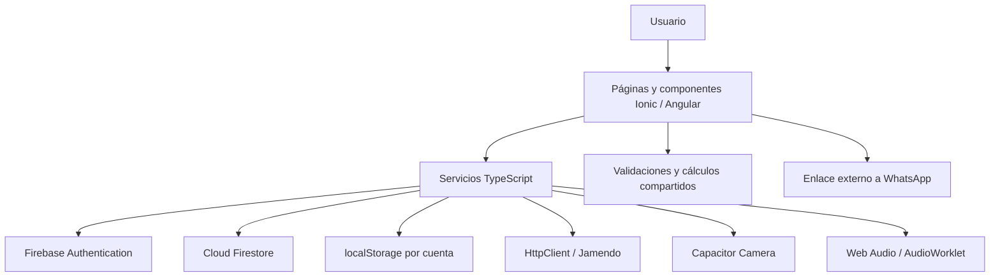

# Arquitectura y estructura

## Enfoque

Passiflora es una aplicación híbrida: Angular e Ionic construyen la interfaz y Capacitor la integra en Android mediante un WebView y plugins nativos. Se organiza por pantallas y funcionalidades, con componentes standalone, servicios inyectables y rutas con carga diferida. No implementa un patrón MVVM estricto ni un servidor propio.



## Directorios

```text
src/
  main.ts                    Arranque, router, HTTP y proveedores Firebase
  global.scss                Tipografía, temas y estilos de overlays
  app/
    app.routes.ts            Rutas principales y protección de sesión
    guards/                  Guardia de autenticación
    tabs/                    Contenedor y rutas de las tres pestañas
    tab1/                    Inicio y accesos a herramientas
    tab2/                    Catálogo de ejercicios y ambientación
    tab3/                    Mi espacio, diario e historial
    pages/                   Login, registro, GAD, pánico, anclaje y herramientas
    services/                Acceso a Firebase, Jamendo, cámara y datos locales
    shared/                  Validaciones, resumen semanal y componentes reutilizables
  assets/
    img/                     Flor de Passiflora y recursos gráficos
    audio/grabador.js         Procesador de audio para capturas de cinco segundos
android/                     Proyecto nativo, permisos, iconos y Gradle
scripts/                     Comprobación independiente del procesador de audio
docs/                        Documentación del proyecto
```

## Responsabilidades

| Pieza | Responsabilidad |
| --- | --- |
| `AuthService` | Registro, inicio/cierre de sesión, consulta y actualización del perfil |
| `sesionGuard` | Esperar la recuperación de Firebase Auth y proteger rutas privadas |
| `DiarioService` | Validar entradas, escribir en Firestore y observar cambios del historial |
| `TarjetasService` | CRUD local de recordatorios, separado por UID |
| `ContactoApoyoService` | Validar y guardar el contacto; construir una URL segura de WhatsApp |
| `JamendoService` | Solicitar catálogo REST, validar JSON y transformar pistas a un modelo tipado |
| `CamaraService` | Verificar permisos antes de fotografiar; abrir el selector de imágenes |
| `GrabacionService` | Capturar audio con AudioWorklet, limitar duración y liberar recursos |
| `ThemeService` | Aplicar la paleta y conservar la preferencia de tema |
| `TabHeaderComponent` | Acceso al espacio de calma, tema y cierre de sesión en los tres tabs |
| `PerfilComponent` | Edición de nombres y gestión del avatar local |
| `ContactoApoyoComponent` | Configurar el contacto o presentar el acceso desde pánico |
| `ResumenEmocionalComponent` | Seleccionar semana y presentar estadísticas del diario |
| `resumen-emocional.ts` | Calcular semanas, conteos, promedios y empates |

Las páginas coordinan interacción y navegación. Los servicios gestionan las operaciones de datos y hardware. Las validaciones y cálculos compartidos permiten verificar reglas sin depender de la interfaz.

## Estado y ciclo de vida

La identidad activa procede de Firebase Auth. El diario se suscribe al historial de esa cuenta y cancela la suscripción al cambiar de usuario o destruirse. Las operaciones asíncronas de perfil, fotos y grabación utilizan comprobaciones de sesión o versiones para descartar resultados que ya no corresponden a la vista activa.

Ionic puede conservar páginas al navegar entre tabs. Por eso algunas pantallas actualizan sus datos en `ionViewWillEnter`, además de utilizar los ciclos de vida de Angular. Al abandonar ejercicios se detienen capturas o temporizadores según la herramienta y se liberan los recursos temporales.

## Diseño visual

La interfaz usa Nunito y variables CSS compartidas. Las paletas clara y oscura se definen en `src/global.scss`; el espacio de pánico mantiene su paleta de calma oscura. Los selectores utilizan overlays de Ionic con estilos de Passiflora.

Android reserva las zonas de barras del sistema mediante `SystemBars` con manejo nativo de insets y `viewport-fit=contain`. La franja del sistema usa morado uniforme e iconos claros. La configuración se encuentra en `capacitor.config.ts` y los recursos nativos de estilos.
