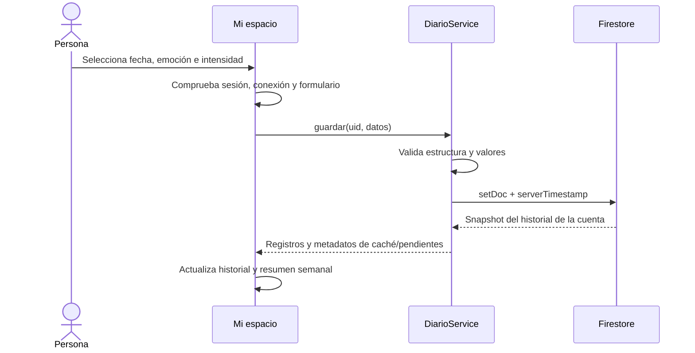

# Datos, permisos y seguridad

## Dónde se guarda cada dato

| Dato | Ubicación | Comportamiento |
| --- | --- | --- |
| Credenciales y sesión | Firebase Authentication / SDK | La app no guarda manualmente la contraseña |
| Perfil: nombre, correo y aceptación de términos | Firestore `usuarios/{uid}` | Vinculado a la cuenta; nombre y apellido editables |
| Registros emocionales | Firestore `usuarios/{uid}/registrosEmocionales/{id}` | Observados en tiempo real |
| Tarjetas | `localStorage`, `passiflora:tarjetas:v1:{uid}` | CRUD local por cuenta |
| Foto de perfil | `localStorage`, `passiflora:avatar:v1:{uid}` | Imagen Data URL; no se sube a Firestore ni Storage |
| Contacto y mensaje | `localStorage`, `passiflora:contacto:v1:{uid}` | Configuración local por cuenta |
| Tema | `localStorage`, `passiflora_modo_oscuro` | Preferencia del dispositivo |
| Fotos y audios del anclaje | Memoria de la sesión del ejercicio | Recursos temporales; no se suben a la cuenta |
| Catálogo y reproducción musical | Respuesta de Jamendo / reproducción en línea | Sin favoritos ni descargas para uso sin conexión |
| Resumen emocional | Cálculo sobre el historial recibido | Sin colección adicional ni envío a servicios analíticos |

La separación de claves locales por UID evita mezclar datos en la interfaz entre cuentas. No equivale a cifrado: no se implementa cifrado propio de `localStorage`. El manifiesto Android mantiene `allowBackup=true`; por tanto, no se debe describir esta versión como excluida de todas las copias de seguridad del sistema. Borrar datos o desinstalar puede eliminar los datos locales.

## Flujo del diario

Cada entrada contiene `fecha`, `emocionPrincipal`, `emoji`, `subemocion`, `intensidad`, `color` y `creadoEn`. El servicio valida fecha de calendario, intensidad entera de 1 a 10 y tipos básicos antes de escribir. El ID se genera al crear el documento. Los indicadores de caché y sincronización pendiente proceden de metadatos del SDK.

El perfil conserva `nombre` como nombre completo para compatibilidad y, después de editarlo, añade `nombres` y `apellido` mediante `updateDoc`. La escritura no reemplaza el correo ni la aceptación de términos. La autorización real de las escrituras depende de las reglas desplegadas de Firestore.

## Autenticación y autorización

- La guardia de rutas espera la restauración de la sesión antes de permitir acceso.
- Los servicios y vistas usan el UID de la cuenta activa y descartan respuestas asíncronas antiguas al cambiar de sesión.
- La validación del formulario y del servicio mejora la integridad de las solicitudes, pero sigue siendo código cliente.
- **Las reglas de Firestore deben exigir `request.auth.uid == uid` en el perfil y en los registros de esa cuenta**, y validar los campos permitidos. Una guardia Angular no sustituye esas reglas.
- Las reglas desplegadas se administran en Firebase; este repositorio no contiene un archivo de reglas ni un despliegue automático. Esta documentación no certifica el estado remoto. Antes de entregar, comprueba en la consola o emulador que otra cuenta no pueda leer ni escribir documentos ajenos.
- La configuración web de Firebase y el Client ID de Jamendo son identificadores del cliente. La seguridad de Firestore no debe depender de ocultarlos. No se requiere incluir claves de servicio, contraseñas o Client Secret de Jamendo.

## Permisos y servicios externos

| Recurso | Implementación y límite |
| --- | --- |
| Cámara | `CAMERA` en el manifiesto; aviso previo y comprobación/solicitud de permiso con Capacitor antes de capturar |
| Galería | Selector de imágenes de Capacitor; sin acceso general a la agenda o a todos los archivos |
| Micrófono | `RECORD_AUDIO` y `MODIFY_AUDIO_SETTINGS`; aviso previo y autorización mediante `getUserMedia` |
| Audio de anclaje | AudioWorklet limita la captura a cinco segundos y genera WAV; abortar detiene las pistas |
| Internet | `INTERNET` para Firebase, Jamendo y los enlaces externos |
| WhatsApp | Enlace HTTPS `wa.me` con número validado y texto codificado; la persona confirma el envío fuera de Passiflora |
| Ubicación | No se solicita GPS; el hardware utilizado para esta entrega es cámara y micrófono |

Jamendo se consulta con `HttpClient`: `GET /v3.0/tracks/`, parámetros de ambientación e instrumental y respuesta JSON. Se valida el estado de la respuesta y se admiten enlaces de los dominios esperados, convertidos a HTTPS. La interfaz muestra autor, enlace a Jamendo y licencia de la pista. Un reproductor activo se limpia al abandonar la pantalla.

## Sin conexión

Las tarjetas y la configuración local pueden consultarse desde una sesión recuperada. Respiración y GAD-7 usan lógica local; cámara y micrófono dependen de permisos y soporte del dispositivo. Crear una cuenta, iniciar una sesión nueva, sincronizar el perfil y obtener música necesitan conexión.

El diario usa `navigator.onLine` y eventos de conexión para ocultar los controles de nuevas emociones. Esta señal no garantiza que Firestore sea accesible: puede haber Wi-Fi sin salida a internet. El historial puede proceder de la caché disponible y se indica en pantalla. No hay una cola de escritura offline diseñada por la aplicación; una escritura ya iniciada puede quedar pendiente en el SDK hasta recuperar conexión. Tampoco se configura aquí una garantía de caché persistente entre reinicios.

## Alcance

La información del diario es sensible. El resumen y el GAD-7 ofrecen orientación, sin promesas de diagnóstico, tratamiento o seguimiento clínico. No se implementan cifrado adicional de datos locales, recuperación propia de contraseña, edición de correo, verificación de titularidad del contacto ni servicios de emergencia automáticos.
