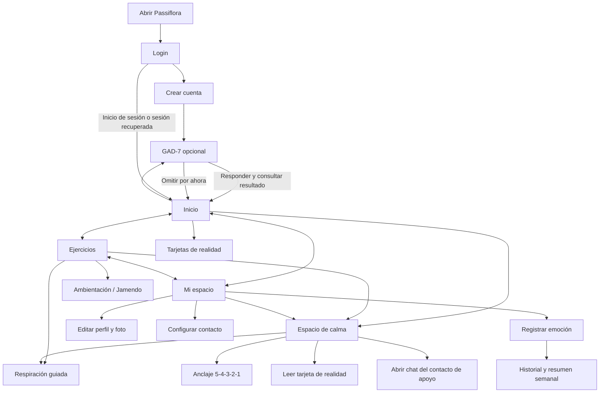
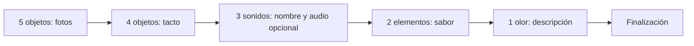

# Flujo de la aplicación

## Navegación principal

## Rutas

| Ruta | Pantalla o comportamiento |
| --- | --- |
| `/login` | Inicio de sesión; puede recuperar una sesión existente |
| `/registro` | Crear cuenta y aceptar términos |
| `/gad7` | Cuestionario y resultado orientativo |
| `/tabs/tab1` | Inicio |
| `/tabs/tab2` | Ejercicios |
| `/tabs/tab3` | Mi espacio |
| `/panico` | Herramientas de calma y contacto de apoyo |
| `/panico/anclaje` | Anclaje, con acceso desde el espacio de calma |
| `/respiracion` | Práctica guiada; admite `origen=panico` para el regreso |
| `/ambientacion` | Música en línea |
| `/tarjetas` | Crear, editar o eliminar recordatorios |
| `/anclaje` | Ruta antigua: redirige a `/panico` |

Las rutas privadas utilizan `sesionGuard`; si no hay sesión, redirigen al login. La ruta raíz y las desconocidas también redirigen a login. El anclaje no aparece como acceso en el catálogo de ejercicios.

## Registro y GAD-7

1. La persona ingresa nombre, apellido, correo y contraseña, y acepta los términos.
2. El formulario valida nombres de al menos cuatro letras, sin números; correo terminado en `.com` o `.co`; y contraseña de ocho caracteres como mínimo, con mayúscula y número.
3. Firebase Authentication crea la cuenta y Firestore almacena el perfil.
4. Se abre el GAD-7. Se puede responder u omitir sin generar un resultado.
5. Al completar las siete preguntas se suman respuestas de 0 a 3: mínima 0–4, leve 5–9, moderada 10–14 y severa 15–21. Se muestran recomendaciones y un aviso sobre su alcance orientativo.
6. Desde Inicio se puede volver a responder. Esta versión no almacena un historial de resultados del GAD-7.

La aceptación de términos tiene una versión registrada. No se implementa un cierre automático de sesión por tiempo.

## Anclaje 5-4-3-2-1

- Para avanzar normalmente se validan los datos requeridos de cada paso; las grabaciones de oído son opcionales.
- «Omitir este paso» permite continuar sin completar sus campos y cancela una grabación activa.
- El icono de salida pide confirmación. Aceptar libera recursos y lleva a Inicio; cancelar permite continuar.
- El aviso de cámara se presenta antes de la primera captura autorizada durante el ejercicio. El permiso del sistema se comprueba antes de abrirla.
- Las capturas de audio duran cinco segundos; al volver a grabar se reemplaza la captura anterior.
- Al finalizar se puede volver al espacio de calma. Las fotos y audios no se envían al servidor.

## Mi espacio

El perfil muestra nombre y correo. Se editan nombre y apellido; la foto puede tomarse, elegirse o quitarse. La edición no cambia correo ni contraseña.

El contacto de apoyo guarda nombre, celular colombiano de diez dígitos comenzando por 3 y mensaje personalizable. El enlace añade `57`, codifica el mensaje y abre WhatsApp. No comprueba que el número tenga WhatsApp ni envía el mensaje automáticamente.

En el diario se elige fecha, emoción principal, subemoción e intensidad de 1 a 10. Al guardar, Firestore actualiza el historial observado. Si se detecta falta de conexión, se ocultan los controles de emociones y se muestra el mensaje de indisponibilidad para guardar.

El historial se agrupa de lunes a domingo. El resumen semanal cuenta cada registro por igual, distingue días registrados, calcula la intensidad promedio e incluye todas las emociones empatadas como más frecuentes. No interpreta esos datos como diagnóstico o mejoría clínica.
